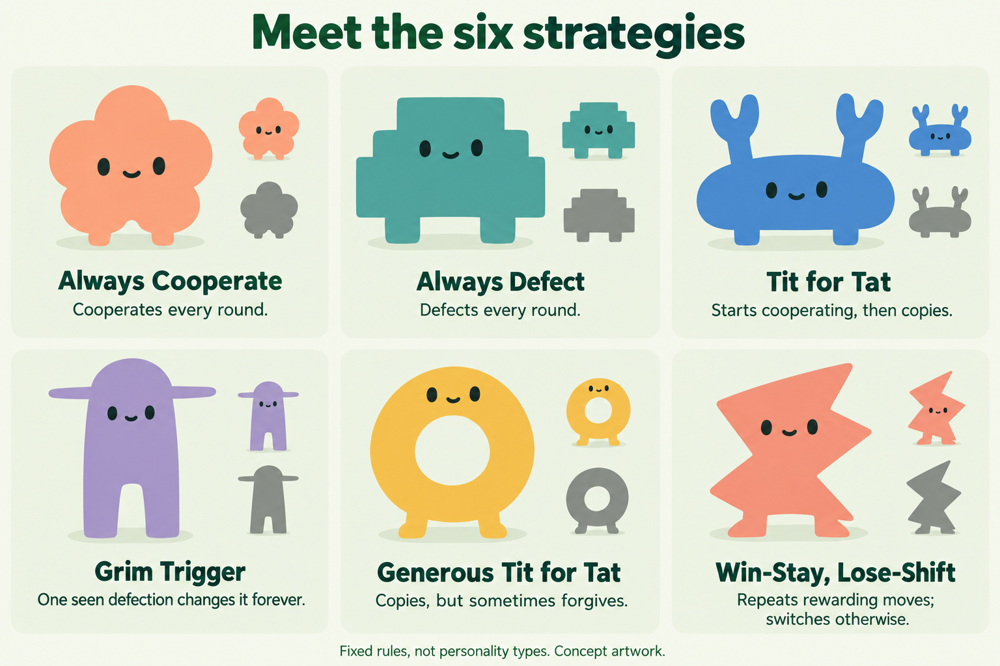

# Strategy avatar cast — concept 1

Historical concept. The later user-defined nice/nasty visual families and cumulative score screen use [production v2](v2-provenance.md). Statements below about non-integration and pending approval describe this first concept, not the current application.

Created on 1 November 2026 using the built-in image generation tool. This is a proposal for review, not an implemented app screen. The application currently uses text strategy identities.

## Design intent

The user requested distinct, instantly recognizable players after finding the experiments and results confusing. Each strategy has a persistent silhouette, colour, face, and written label. All six receive equally appealing expressions to avoid treating cooperation or defection as a personality or moral judgement.

- Always Cooperate: scalloped apricot shape.
- Always Defect: stepped teal block.
- Tit for Tat: wide blue shape with forked ears.
- Grim Trigger: tall lavender arch with a wide brim.
- Generous Tit for Tat: golden open ring.
- Win-Stay, Lose-Shift: coral zigzag.

The shapes are arbitrary identities, not scientific representations of the strategies. Formal rules remain defined in [simulation-rules.md](../../simulation-rules.md). The Grim Trigger caption abbreviates the rule: after a perceived defection, it defects for the rest of that encounter; its state resets for the next encounter. Win-Stay, Lose-Shift repeats its actual action after earning 3 or 5 points, otherwise switches.

## Review limits

The sheet includes small repeats and monochrome silhouettes to explore recognition. It is not an actual 32px interface test. Before integration, each approved identity needs a separate consistent asset and checks at 32, 48, and 96 CSS pixels, on both app grounds, in colour and grayscale. Two instances of the same strategy should share an identity and receive explicit Player 1/Player 2 labels. Strategy names and rules must remain accessible as text.

Instant recognition and improved experiment comprehension have not been established with users. The cast is not approved merely because this sheet exists.

## Provenance and exact generation prompt

Built-in `image_gen.imagegen`, new generation without reference images, opaque background. The original generated PNG was copied into this project without editing. The prompt was:

> Create one polished character-design CAST SHEET for a beginner's prisoner's dilemma exploration app. This is a concept preview, not a screenshot of a working UI. Landscape 3:2 composition, six generous cells in 3 columns by 2 rows on a very pale green-white #f7f8ed ground, forest-green #0b5735 typography and restrained peach accents. Title: 'Meet the six strategies'. Each cell contains ONE large distinct abstract creature, its exact strategy name, a short rule, and a small repeated 32px-style avatar plus a small grayscale silhouette of the SAME creature for recognition checking. Cast must be instantly distinguishable by overall outline even without colour, not six variations of a circular face. Cohesive flat editorial character illustration, crisp edges, thick simple forms, minimal tiny details, warmly curious but emotionally neutral. Equally appealing characters, same tiny calm mouth and simple dark eyes: no heroes, villains, angry eyebrows, halos, weapons, moral coding, gender or cultural stereotypes. Clear silhouettes, enough empty space between characters. Character 1: compact scalloped five-lobed pebble creature, apricot; label 'Always Cooperate'; rule 'Cooperates every round.' Character 2: squat broad box creature with stepped rectangular shoulders, teal; label 'Always Defect'; rule 'Defects every round.' Character 3: wide low bean creature with two unmistakable tall forked ears, blue; label 'Tit for Tat'; rule 'Starts cooperating, then copies.' Character 4: narrow tall arch creature with a flat horizontal brim, lavender; label 'Grim Trigger'; rule 'One seen defection changes it forever.' Character 5: open doughnut-shaped creature with a large central hole, eyes on the upper ring and little legs, golden yellow; label 'Generous Tit for Tat'; rule 'Copies, but sometimes forgives.' Character 6: asymmetric bold zigzag-shaped creature with two small feet, muted coral; label 'Win-Stay, Lose-Shift'; rule 'Repeats rewarding moves; switches otherwise.' No accessories that disappear at small sizes. No gradients, no 3D renders, no glossy generic emoji style. Their outline alone must distinguish every member. Labels must be legible and exact. Small samples must faithfully repeat the large identities. Bottom note: 'Fixed rules, not personality types. Concept artwork.'
